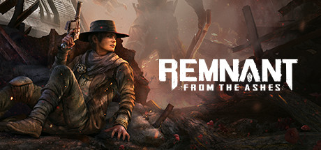

**The Last Remnant follows young Rush Sykes searching for his kidnapped sister in a world where ancient artifacts called Remnants grant their wielders incredible power. Features a unique party-of-parties Battle Formation system and one of the most complex progression systems in JRPGs.**

---

## 📖 About

The Last Remnant follows young Rush Sykes searching for his kidnapped sister in a world where ancient artifacts called Remnants grant their wielders incredible power. Features a unique party-of-parties Battle Formation system and one of the most complex progression systems in JRPGs.

## ⚠️ Problems Without Trainer

| Problem | Status |
|---------|--------|
| **Battle Formation Complexity** — Optimizing unions of units across formations requires deep system knowledge | ✅ Solved |
| **Combat AP Management** — Poor AP distribution across formations creates suboptimal battle results | ✅ Solved |
| **Morale System** — Losing key combat units tanks morale, making recovery very difficult | ✅ Solved |
| **Power Gap** — Certain bosses are dramatically harder than surrounding content without warning | ✅ Solved |

## ✅ Solution

The **The Last Remnant Trainer** solves all these issues by giving you complete control over the game.

## 🎯 Full Feature List

- Unlimited Resources
- God Mode / Invincibility
- Instant Skill Cooldown
- One-Hit Kill
- Freeze Game Timer
- Unlock All Items & Achievements
- Custom Speed Multiplier
- Save State Anywhere

## 🚀 Quick Start

1. **Disable Windows Defender** temporarily (trainer may trigger false positive)
2. Download the trainer from the button above
3. Launch The Last Remnant
4. Run the trainer as Administrator
5. Activate desired cheats with hotkeys

## 💎 Free vs Paid

| Feature | Free | Pro |
|---------|------|-----|
| Basic God Mode | ✅ | ✅ |
| Unlimited Resources | ✅ | ✅ |
| All Advanced Cheats | ❌ | ✅ |
| Auto-Updates | ❌ | ✅ |
| Priority Support | ❌ | ✅ |

## 💻 Requirements

- Windows 10/11 (64-bit)
- The Last Remnant (any version)
- .NET Framework 4.8+
- DirectX 11+

## 🍎 macOS

macOS users can use our alternative tool:

## ⚖️ Legal

This trainer is for educational and single-player use only. Use responsibly.

---

